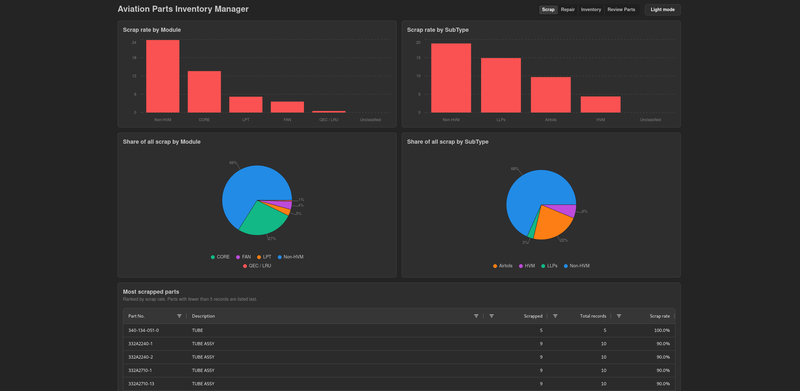

# Aviation Part Inventory Manager



A web app that helps discover insights for aircraft engine inventory management. It turns a raw parts export into clean data and shows where value is made or lost, and which parts on hand to repair, sell, or scrap.

## Setup and run

Requirements: Docker with Compose was used, this makes the app really easy to deploy in production.

```bash
docker compose up --build
```

- Frontend: http://localhost:5173
- Backend API: http://localhost:8080 (docs at `/docs`)

The backend runs `cleaning.py` before starting FastAPI, so the clean database is rebuilt from the raw export on boot. Local rebuild and tests:

```bash
cd backend && uv run python cleaning.py
cd backend && uv run pytest
```

## Data

The raw file is `backend/data/data.csv` (39,338 rows, 25 columns) and is never edited. Cleaning writes `parts_clean` and `cleaning_log` to `backend/data/inventory.db`. Impact: 39,338 raw → 35,289 clean; 4,049 rows are dropped (2,333 misaligned rows, 204 `Invoiced` rows with no sales price, and 1,512 exact duplicates, counted after the first two rules).

### Data issues and how they were handled

| Issue | Rows | Handling |
| --- | --- | --- |
| Encoding | All | Read as latin-1, not UTF-8. |
| Columns shifted: `Type` is numeric and values are moved left | 2,333 | Dropped; the missing field cannot be identified reliably. |
| `Invoiced` rows with no sales price | 204 | Dropped; sold parts need a price for margins. |
| Exact duplicate rows | 1,512 | Dropped after the two rules above. |
| `Module`/`SubType`, `Condition`, or `WHSE` blank or `NULL` | 1,012 / 863 / 12,691 | Labelled `Unclassified`. |
| `QTY` blank on inventory rows | 863 | Left as `NULL`, not filled with 0 or 1. |
| `Invoice Date` format | Invoiced rows | Parsed as `m/d/yyyy` and stored as `YYYY-MM-DD`; cleaning stops on a parse failure. |
| `OH_DATE` format | 1 non-placeholder value | Set to `NULL`; the row is kept because `OH_DATE` is needed only for sell-through. |
| `Updated_Description` contains taxonomy labels such as `Non-HVM` | 12,462 | Used conditionally: shown when it holds a real description (e.g. `Starter Valve`), raw `description` used otherwise (alphabetically last if a part has several). 21,937 descriptions improved. |
| Sold rows with repair cost 0 | 1,265 | Kept; margin blank, labelled "No repair cost recorded". |
| Sold rows with sales price 0 or less | 152 | Kept; margin blank, labelled "Non-positive sales price"; includes likely credits/reversals. |
| Sold rows with price at or below repair cost | 358 | Kept and included in margins as real losses. |

Unpriced inventory and scrapped rows are kept for the on-hand and scrap views.

Some issues remain: `OrderNo` has decimal/corrupted values; `Condition` mixes letters with numbers; and `NULL`/`N/A` placeholders remain in untouched text columns such as `SN`, `FSC`, `PO_No`, and `OrderNo`, however these are not used in the analysis so they do not corrupt the data.

## Views and definitions

All tables use AG Grid sorting and filtering in the browser, 15 rows per page. Parts with fewer than 5 relevant records are ranked last with a "Low sample" badge.

### Scrap view

- **Scrap rate:** scrapped ÷ all records in the group; per part, scrapped ÷ all records for that `PART`. Parts with fewer than 5 records rank last because 1 of 1 would show as 100%. **Share of scrap:** scrapped in group ÷ all scrapped.
- Rate and share charts are shown by `Module` and `SubType`, plus a per-part table ranked by scrap rate (`GET /parts/scrapped/summary`, `GET /parts/scrapped`).

### Repair economics view

- **Margin:** (unit sales price − unit repair cost) ÷ unit sales price. Blank margin means no repair cost or a non-positive sales price. **Weak margin** is below 20%, including negative.
- Margin is shown as box plots by `Module` and `SubType` (median, middle half, and 10th/90th-percentile whiskers on a −100% to 100% axis), plus per-part and sold-record tables (`GET /parts/sold`).

### Inventory and sell-through view

- **Actual days to sell:** invoice date − `OH_DATE` (`m/d/yyyy`). **Expected days:** `AvgNoofSalesDays`, rounded to whole days. **Days over expected:** actual − expected per record; charts show the median of these differences, not median actual − median expected.
- 6,064 of 7,277 sold records have a usable on-hand date. Charts compare actual and expected median days by `Module` and `SubType`; the table groups on-hand `QTY` and distinct part counts by `Module`, `SubType`, warehouse, and condition (`GET /sellthrough/summary`, `GET /parts/inventory`).
- Limits: `OH_DATE`'s business meaning (arrival, listing, or repair completion) is not defined in detail. Almost all groups sell faster than `AvgNoofSalesDays` predicts using this method.

### Decision-support view: parts to review

`GET /parts/review` ranks 2,867 parts with positive on-hand quantity by failed checks, then estimated total repair cost (`on-hand qty × average unit repair cost`).

- **High scrap:** scrap rate ≥ 20% with at least 5 records. **Weak margin:** median margin < 20% with at least 5 margin-bearing sales. **Slow:** median days to sell > 180 with at least 5 dated sales.
- A check with too little evidence is a dash plus "Low sample", not a failure or a pass.
- Suggested actions: margin ≥ 20% = "Repair & sell"; 0–20% = "Pricing review"; below 0% = "Scrap candidate"; fewer than 5 margin samples = "Manual review".
- Limits: 2,024 on-hand parts have never sold, so they have no margin/days evidence and remain manual. Estimated repair cost is calculated with this snapshot's data, more historical data can improve this metric.

## What I would do with more time

- Re-align the seemingly shifted rows where the missing field can be identified to save more data.
- Clarify the business meaning of `OH_DATE` and other columns so that I can use them better.
- Add CSV export for the scrap and margin views (currently csv export of the full dataset is in an API route).

## How AI tools were used

I used AI tools to help me quickly investigate the data through scripts, test the backend by generating test data, generating code segments to review, and automating installation of dependencies. I also used to run testing loops and make quick changes to the visual color-scheme and layout.
